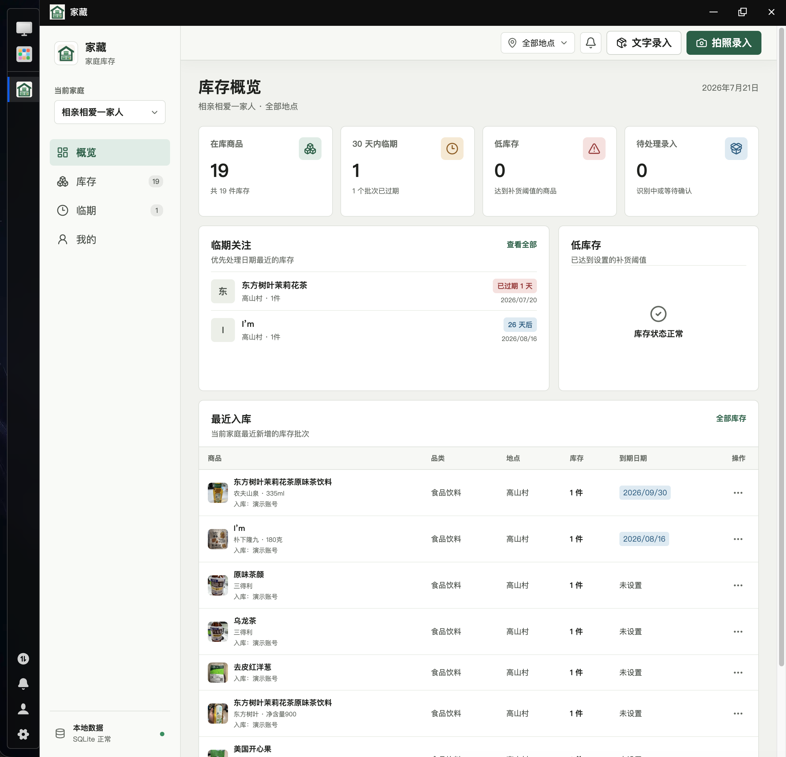
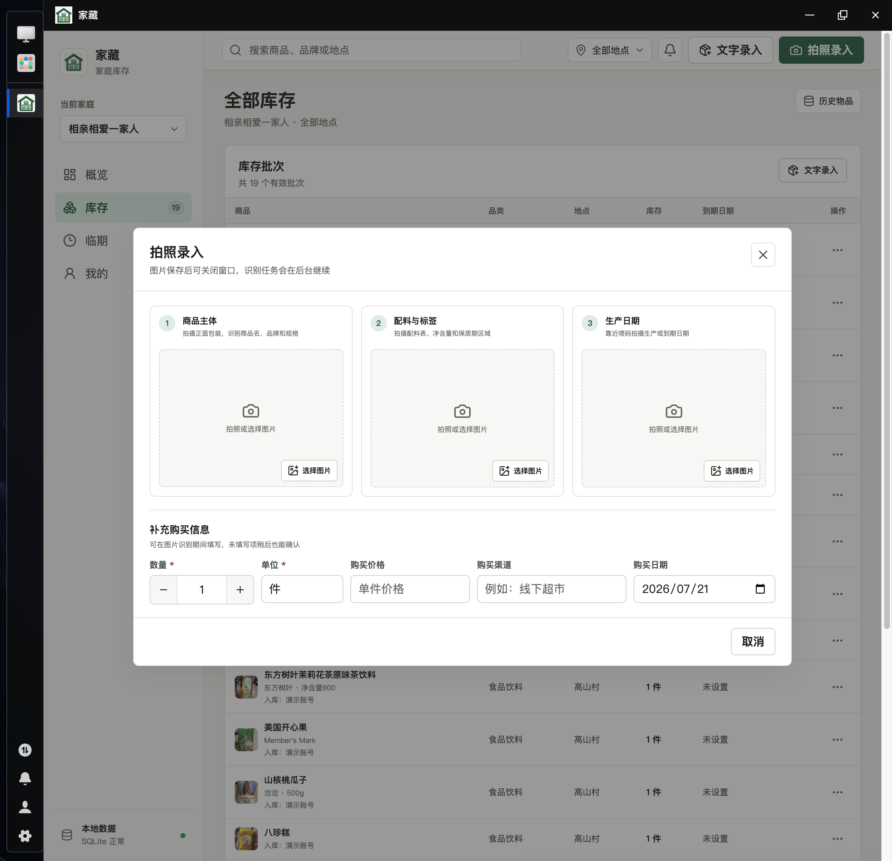
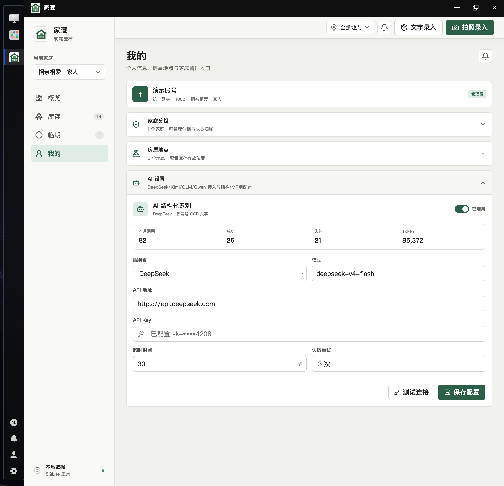
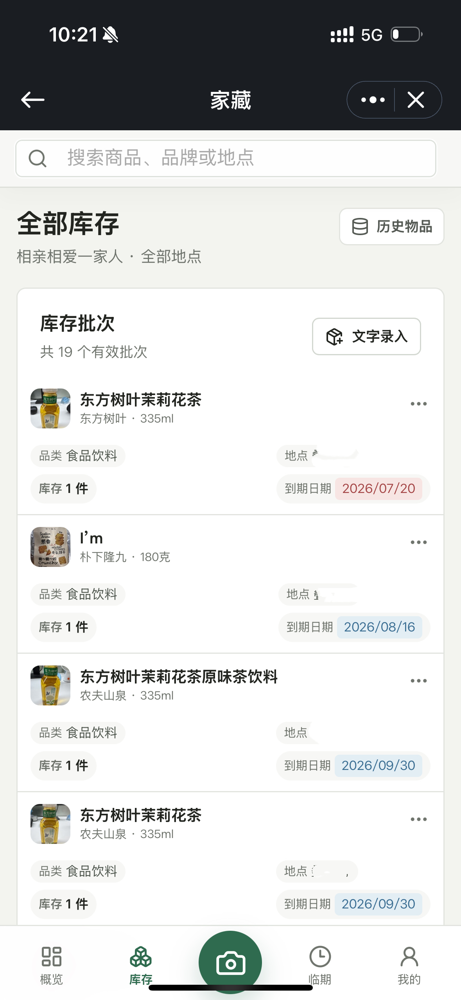
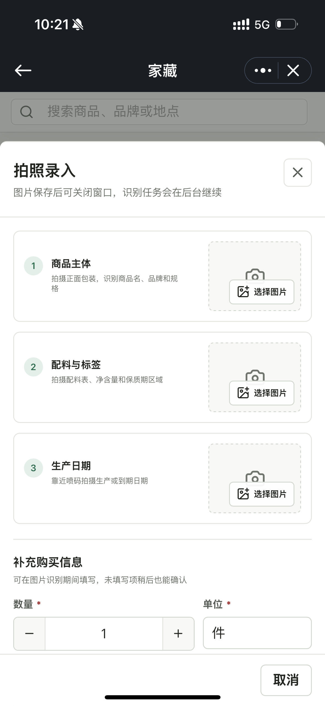

# 家藏

家藏是运行在 fnOS 上的家庭库存应用，用来记药品、囤货、耗材和工具：放在哪、还剩多少、什么时候到期。生鲜和零散日用品不必记。

当前版本是 **1.0.0**。一个家庭可以有多名成员、多处房屋，每处房屋下可以记冰箱、药箱这类存放位置。入库可以打字，也可以拍照。拍照默认一张图；需要时再分三步拍主体、标签和日期。图片保存后可以关掉页面，OCR 和 AI 在后台继续。字段齐了会入库，缺了就留在待确认。

库存可以消耗、用完、丢弃、转到别的地点或盘点。临期和低库存在概览里能直接点进去。外部推送支持企微、飞书、钉钉、Bark 和 Webhook。

1.0.0 还不包含站内提醒中心、操作审计、完整备份恢复和条形码。这些见 [家庭物品管理应用-TODO.md](./家庭物品管理应用-TODO.md)。真机上的安装、升级和 OCR 性能也还没验收，见 [docs/FNOS_DEVELOPMENT.md](docs/FNOS_DEVELOPMENT.md)。

## 界面预览

PC 端采用左侧家庭导航 + 顶部快捷操作，适合在桌面浏览库存、配置家庭和 AI；触屏端采用底部导航和更紧凑的库存卡片，方便在储物间、厨房、冰箱前快速查看和拍照入库。

| 场景 | 预览 |
| --- | --- |
| PC 库存概览 |  |
| PC 拍照录入 |  |
| PC 我的与 AI 设置 |  |
| 触屏全部库存 |  |
| 触屏拍照录入 |  |

更多页面截图可查看 [snapshot](./snapshot/) 目录，包括 PC 库存页、触屏概览、触屏临期管理和触屏我的配置页。

## 当前功能

- 多家庭、多成员、多房屋地点，地点下可记存放位置。
- 使用 fnOS 登录身份，按家庭成员校验数据权限。家庭和成员管理需要管理员。
- 文字录入主路径是名称、品类、放在哪里、数量和到期。品牌、规格、价格、渠道和低库存阈值可以跳过。
- 拍照录入默认一张图。三步精拍分别拍商品主体、配料或标签、日期。
- 图片上传后即保存。OCR、规则解析和 AI 在后台执行，可以重跑 OCR、重新提取或重试失败任务。
- 名称、品类、地点、数量和单位齐了才会自动入库。食品还要有配料或可信保质期，否则进入人工确认。
- 商品主体图做库存封面，生成 120×120 缩略图。
- 已入库物品可以改信息。数量用消耗、用完、丢弃、转移或盘点，不在编辑里改。
- 历史物品只列出已经离库的批次。
- 库存列表每页最多 20 条，滚动继续加载。可按商品名、品牌、规格、品类和地点搜索。
- 概览里的临期、低库存、待处理录入可以点进去。低库存进入后只看达到补货阈值的商品，可关掉这个筛选。
- 外部推送按每天或每周发送临期和低库存摘要。

## 典型使用流程

### 1. 初始化家庭与地点

管理员在“我的”里维护家庭、成员、房屋地点和存放位置。家庭用来隔开库存，例如“上海家”和“广西老家”。房屋地点是一套房子或一处住所，存放位置是这套房子里的冰箱、药箱、橱柜。

普通成员只能看到自己加入的家庭。没有管理员权限时，不能改家庭和成员。

### 2. 入库

应用支持两种入库方式：

- 拍照录入：先选一张图，再填数量、单位和放在哪里。价格、购买日期和渠道可以以后再补。要拍得更全时，改用三步精拍。
- 文字录入：填名称、品类、位置、数量。需要保质期的品类再选到期日，可以用 +3月、+6月、+1年、+2年。

拍照录入的图片一旦上传成功，草稿和图片就已经保存，用户可以关闭弹窗或离开页面；OCR、规则解析和 AI 结构化提取会在后台继续执行。

### 3. OCR 与 AI 整理

后台会先使用本地 OCR 识别图片文字，再用规则提取商品名称、规格、生产日期、保质期等候选字段；启用 AI 后，会把三张图的 OCR 文本整理成“商品主体文案 / 配料表与标签文案 / 生产日期文案”三段，再交给 AI 补全结构化字段。

如果字段达到保守完整度门槛，会自动入库；如果缺少关键信息，会进入拍照草稿详情等待人工确认。草稿详情中可以查看 OCR 原文、候选字段，并支持重新 OCR 或重新 AI 提取。

### 4. 日常管理

库存页可以搜索、按地点和存放位置筛选，并分页加载。每个批次可以改商品信息，也可以消耗、用完、丢弃、转移或盘点。

临期页列出即将到期和已经过期的批次。历史物品页只看已经用完、丢弃或转走的批次。

## 技术栈

- Vue 3 + Vite
- Nitro 3
- Node.js 22 内置 `node:sqlite`
- SQLite + WAL
- PP-OCRv4 mobile + RapidOCR + OpenVINO CPU
- OpenAI-compatible AI Provider
- fnOS Native `.fpk` 打包流程

项目基于模板仓库 [timor-m/fnos-app-template](https://github.com/timor-m/fnos-app-template) 初始化。

## 开发

```bash
npm ci
npm run dev
```

- Nitro 页面与 API：<http://127.0.0.1:3333/app/fnos-app-family-stock/>
- Vite 页面：<http://127.0.0.1:3334/app/fnos-app-family-stock/>

端口被占用时可使用：

```bash
APP_PORT=3340 WEB_PORT=3341 npm run dev
```

构建并运行生产产物：

```bash
npm run build
npm start
```

测试：

```bash
npm test
```

## 目录

```text
packages/ui/                 Vue 前端
packages/server/database/    SQLite Schema 与连接
packages/server/services/    领域服务、OCR/AI 队列与业务逻辑
packages/server/routes/api/  Nitro API
packages/ocr-worker/         单进程 Python OCR Worker
packages/assets/             fnOS 图标资源
scripts/                     开发、构建和打包脚本
template.config.json         fnOS 应用配置
```

## 数据目录

开发环境：

```text
.data/db/          SQLite 数据库
.data/images/      原始图片和 120x120 封面缩略图
.data/models/      OCR 模型
.data/backups/     数据库备份
.data/logs/        应用日志
.data/ocr-venv/    OCR Python 虚拟环境
.data/secrets/     AI 配置本机加密密钥
```

fnOS 安装环境：

```text
TRIM_PKGVAR/data
TRIM_PKGVAR/log
```

应用升级时，只要 fnOS 的持久化数据目录不被删除，SQLite 数据库、图片、OCR 虚拟环境、AI 加密密钥和日志不会随应用包重装丢失。备份/迁移时必须同时保留数据库、图片目录和 `secrets/` 目录，否则已保存的 AI API Key 无法解密。若用户在 fnOS 卸载时选择同时删除应用数据，则上述持久化数据也会被清除。

## OCR 运行环境

图片上传、草稿和任务队列不依赖 Python，可以先使用。要在开发机安装本地 OCR：

```bash
sh packages/ocr-worker/setup-runtime.sh
```

默认配置：

```text
OCR_PYTHON_BIN=.data/ocr-venv/bin/python
OCR_WORKER_SCRIPT=packages/ocr-worker/worker.py
OCR_SETUP_SCRIPT=packages/ocr-worker/setup-runtime.sh
OCR_POLL_INTERVAL_MS=1500
```

fnOS 包会携带 Worker 脚本和安装脚本。管理员可在应用内触发 OCR 运行环境安装，虚拟环境安装在应用持久化数据目录。OCR 使用单工作进程，避免在 NAS 上抢占过多资源。

生产日期图片会启用额外的轻量增强识别：放大、灰度、对比度增强、锐化、二值化和反色二值化，再合并 OCR 结果。这样可以提高瓶身/包装喷码、点阵日期和低对比度日期的识别率。对于生产日期图中只有 `20250913 113233 HY6b` 这类裸日期、没有“生产日期”文字的情况，规则层也会按生产日期候选处理。

目标 Intel J4105 仍需真机最终验收：确认 OpenVINO 不触发 `Illegal instruction`，记录 1080p 图片耗时，并观察连续识别时内存是否稳定。

## AI 结构化提取

AI 默认关闭。管理员可在“我的 / AI 设置”中启用并配置服务商、API 地址、模型、API Key、超时和重试次数。

AI 配置按服务商独立保存。切换 DeepSeek、Kimi、GLM、Qwen 时，只会切换当前使用的 Provider，不会清空其他服务商已经保存的 API 地址、模型和 API Key；旧版本的单份 AI 配置会在读取时兼容为当前 Provider 的配置。

当前支持 OpenAI-compatible Chat Completions 风格 Provider：

| Provider | 默认 API 地址 | 默认模型 |
| --- | --- | --- |
| DeepSeek | `https://api.deepseek.com` | `deepseek-chat` |
| Kimi | `https://api.moonshot.ai/v1` | `kimi-k3` |
| GLM | `https://api.z.ai/api/paas/v4` | `glm-5.2` |
| Qwen | `https://dashscope.aliyuncs.com/compatible-mode/v1` | `qwen-plus` |

环境变量：

```text
AI_ENABLED=true
AI_PROVIDER=deepseek|kimi|glm|qwen
AI_API_BASE=https://...
AI_API_KEY=***
AI_MODEL=...
AI_TIMEOUT_SECONDS=30
AI_MAX_RETRIES=1
```

兼容旧 DeepSeek 环境变量：

```text
DEEPSEEK_API_BASE=https://api.deepseek.com
DEEPSEEK_API_KEY=***
DEEPSEEK_MODEL=deepseek-chat
```

系统默认不向 AI Provider 发送原始图片，只发送 OCR 后的文本和必要字段上下文。为了降低噪音，AI 输入会把 OCR 文本整理为三块 Markdown 文案：

```text
### 商品主体文案
东方树叶
茉莉花茶

### 商品配料表与标签文案（可能含产品名称、保质期、配料、品牌、规格）
产品名称：东方树叶茉莉花茶原味茶饮料
保质期：9个月
配料表：水、茉莉花茶、维生素C、碳酸氢钠

### 商品生产日期/到期日期文案（可能是喷码或批号）
20250913 113233 HY6b
```

品类、已有可信字段和待提取字段会作为简短上下文一并提供，用于约束 AI 只返回系统支持的字段。API Key 在服务端使用 AES-256-GCM 加密后写入 SQLite，加密密钥单独保存在持久化数据目录的 `secrets/ai-settings.key`，接口只返回掩码。

AI 不可用时，OCR 规则结果仍会保留，草稿进入待确认状态，不阻塞人工入库。连接测试和提取调用会记录服务商、模型、耗时、状态及 Token 用量，不记录 API Key。

## 当前边界

- OCR 识别生产日期时已经针对喷码做增强，但极端反光、严重倾斜、模糊、遮挡或非常浅色的点阵日期仍可能识别失败。
- AI 只处理 OCR 文本，不识别原始图片；如果 OCR 本身漏字，AI 只能基于已有文本补全结构化字段。
- 自动入库偏保守：字段不齐，或食品没有配料信息时，留在待确认，不会直接写入库存。
- 存放位置记到冰箱、药箱、橱柜这一层。同一位置里的层架和箱号先不拆。
- 历史物品只看已经离库的批次，不是完整操作流水。操作记录保存在数据里，界面上还没有审计页。

## 构建 fnOS 安装包

生成 `app.tgz`：

```bash
npm run pack:app
```

生成 `.fpk`：

```bash
npm run download:fnpack
npm run pack:fpk
```

构建产物位于 `dist/`。`pack:fpk` 会自动构建、生成 `app.tgz`、检查 manifest/权限/网关/图标/OCR Worker/checksum，再调用官方 `fnpack`。

安装后入口使用 `/app/fnos-app-family-stock`，服务监听 `${TRIM_APPDEST}/app.sock`。fnOS 网关负责校验 NAS 登录态，并转发用户身份请求头；应用继续负责家庭、成员和数据归属等业务鉴权。

## 当前 API

- `GET /api/health`
- `GET /api/session`
- `GET /api/system`
- `GET /api/config`
- `GET /api/families`
- `POST /api/families`
- `PATCH /api/families/:familyId`
- `GET /api/families/:familyId/members`
- `POST /api/families/:familyId/members`
- `DELETE /api/families/:familyId/members/:userId`
- `POST /api/families/:familyId/locations`
- `PATCH /api/locations/:locationId`
- `DELETE /api/locations/:locationId`
- `POST /api/locations/:locationId/storage-places`
- `PATCH /api/storage-places/:storagePlaceId`
- `DELETE /api/storage-places/:storagePlaceId`
- `GET /api/categories`
- `GET /api/dashboard?inventoryLimit=20&inventoryOffset=0&search=...&stock=low`
- `GET /api/notifications/push/settings`
- `PUT /api/notifications/push/settings`
- `POST /api/notifications/push/test`
- `POST /api/notifications/push/send-now`
- `POST /api/inventory/intakes`
- `PATCH /api/inventory/batches/:batchId`
- `POST /api/inventory/batches/:batchId/operations`
- `GET /api/inventory/history?familyId=...&locationId=...`
- `POST /api/intakes`
- `GET /api/intakes?familyId=...`
- `GET /api/intakes/:intakeId`
- `PATCH /api/intakes/:intakeId`
- `POST /api/intakes/:intakeId/images`
- `POST /api/intakes/:intakeId/retry`
- `POST /api/intakes/:intakeId/cancel`
- `POST /api/intakes/:intakeId/complete`
- `POST /api/intakes/:intakeId/ocr/rerun`
- `POST /api/intakes/:intakeId/ai/reextract`
- `GET /api/media/:mediaId`
- `GET /api/ocr/status`
- `POST /api/ocr/install`
- `GET /api/ai/settings`
- `PUT /api/ai/settings`
- `POST /api/ai/test`
- `GET /api/ai/status`

fnOS 开发规范、生命周期和发布检查见 [docs/FNOS_DEVELOPMENT.md](docs/FNOS_DEVELOPMENT.md)。
